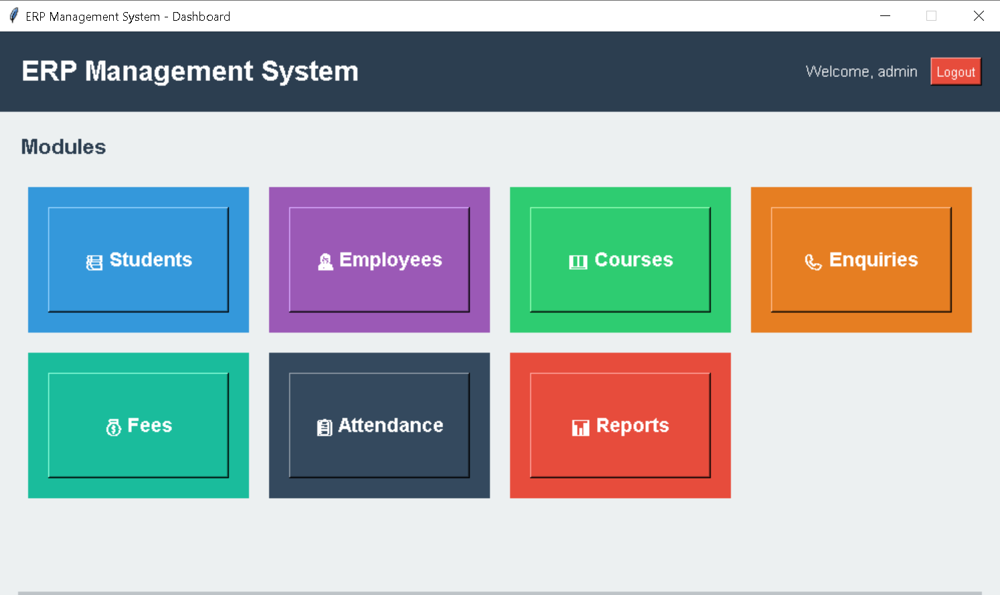

# Institutional ERP Management System

A robust, full-stack desktop Enterprise Resource Planning (ERP) application designed to automate, streamline, and manage institutional workflows. Built completely using Python's Object-Oriented Programming (OOP) principles, Tkinter for a modern GUI dashboard, and MySQL for secure, real-time relational database management.

<!-- Main Dashboard Interface Screenshot -->
<p align="center">
  
</p>

---

## Tech Stack & Architecture

* **Frontend/UI:** Python (Tkinter library) with customized grid layouts, dynamic color palettes, and responsive widgets.
* **Backend Logic:** Python (OOPs, Database Connection Handlers).
* **Database:** MySQL Server (Relational Database Management System).
* **Database Driver:** `mysql-connector-python` API for real-time CRUD query execution.

---

##  Key Features & Core Modules

### 1. Centralized Admin Dashboard
* A clean, modern, and tile-based responsive dashboard layout for seamless module switching.
* Secure "Welcome Admin" banner with immediate data-stream encapsulation and a working **Logout** handler.

### 2. Student Lifecycle Management
* **Full CRUD Support:** Flawless operations to **Add, Update, Delete, and Clear** student records.
* **Dynamic Data Grids:** Integrated Tkinter `TreeView` component displaying structural information (ID, Name, Course, Phone, Email, Fees).
* **Interactive Controls:** Automated dropdowns for course selection linked dynamically with structural references.

### 3. Employee & Staff Directory
* Dedicated module tracking the internal workforce infrastructure.
* Organizes crucial corporate details like Department allocations (e.g., HR, Finance, Academics), unique IDs, and operational metrics.

### 4. Advanced Analytics & Reports Dashboard
* Provides strategic management summaries over dynamic business operations.
* **Course Statistics View:** Tracks live counts of active enrolled students, relative course fees structural metrics, and class durations.
* Modular support for structural outputs: *Student Reports*, *Fee Collection logs*, *Attendance Overviews*, and *Staff Analytics*.

---

##  Database Schema & Normalization

The backend utilizes an optimized relational schema built within `erp_db`. Tables are normalized with proper primary keys, structural constraints, and foreign keys mapping datasets accurately.

### Sample Data Representation (`students` table):
* `student_id` (INT, Primary Key, Auto-Increment)
* `student_name` (VARCHAR)
* `course_id` (INT, Foreign Key referencing courses data)
* `phone` (VARCHAR)
* `email` (VARCHAR)
* `total_fees` (DECIMAL)
* `created_at` (TIMESTAMP, Automatic Database Accountability Logging)

---

##  Installation & Local Setup

### Prerequisites
Make sure you have Python 3.x and MySQL Server installed on your machine.

### 1. Clone the Repository
```bash
git clone [https://github.com/sachiuhhigt/ERP-Management-System.git](https://github.com/sachiuhhigt/ERP-Management-System.git)
cd ERP-Management-System